<p align="center">
  
</p>

<p align="center">
  <a href="https://github.com/ishandutta2007/Awesome-Awesome-Awesome"></a><a href="https://discord.gg/jc4xtF58Ve"></a>
  <a href="https://github.com/ishandutta2007/Awesome-Mobile-Raster-Graphics-Editor/stargazers"></a>
  <a href="https://github.com/ishandutta2007/Awesome-Mobile-Raster-Graphics-Editor/network/members"></a>
  <a href="https://github.com/ishandutta2007/Awesome-Mobile-Raster-Graphics-Editor/blob/main/LICENSE"></a>
  <a href="https://github.com/ishandutta2007/Awesome-Mobile-Raster-Graphics-Editor/issues"></a>
  <a href="https://github.com/ishandutta2007/Awesome-Mobile-Raster-Graphics-Editor/pulls"></a>
  <a href="https://github.com/ishandutta2007"></a>
</p>

---

# 🎨 Awesome Mobile Raster Graphics Editor

> **A curated catalog of premier SaaS platforms and open-source GitHub projects for mobile raster graphics editing, digital painting, touch-optimized sketching, and photo retouching on iPad, Android, and tablets.**

Mobile raster graphics editors have evolved from lightweight finger-painting novelties into desktop-class creative powerhouses. Driven by high-refresh OLED displays, low-latency active styluses (Apple Pencil, Samsung S-Pen), and modern GPU APIs (Metal, Vulkan, WebGPU), today's tablet software supports 120 FPS brush engines, multi-layer compositing, non-destructive adjustment masks, and CMYK/HDR color management workflows.

Whether you are a concept artist seeking a Procreate alternative, a comic illustrator needing perspective rulers on Android, or an engineer building the next touch-first graphics engine, this guide tracks the leading commercial SaaS products and open-source codebases.

---

## 📑 Table of Contents

- [📊 Sector Overview & Market Dynamics](#-sector-overview--market-dynamics)
- [🏢 SaaS & Commercial Mobile Raster Editors](#-saas--commercial-mobile-raster-editors)
- [💻 Open-Source Mobile Raster Graphics Editors](#-open-source-mobile-raster-graphics-editors)
- [🔍 Key Architectural & Selection Criteria](#-key-architectural--selection-criteria)
- [📈 Star History](#-star-history)
- [💖 Support & Community](#-support--community)
- [🤝 How to Contribute](#-how-to-contribute)
- [⚖️ Disclaimer & License](#-disclaimer--license)

---

## 📊 Sector Overview & Market Dynamics

The global digital painting and mobile graphics editor market is valued at **$1.85 Billion in 2024–2026** and is projected to expand to **$3.8 Billion by 2032** at a **9.4% CAGR**, accelerated by the ubiquity of high-DPI stylus tablets and mobile creative workflows. The sector exhibits a **moderately concentrated, winner-take-most structure** at the top tier—where Procreate anchors the iPad digital art ecosystem and Adobe captures enterprise creative suite subscribers—coexisting with a **vibrant, fragmented tier** of ad-supported freemium suites (ibis Paint, MediBang) and emerging open-source native tablet engines (Krita, Capy Canvas) addressing cross-platform freedom, privacy, and subscription fatigue.

---

## 🏢 SaaS & Commercial Mobile Raster Editors

The table below catalogs the leading commercial and SaaS mobile raster graphics editors, sorted in descending order by **Company Scale (Revenue / Valuation)**.

| 🎨 Product & Platform | 🏢 Company Scale (Revenue / Valuation) | 💰 Starting Tier Pricing | 🆓 Free Tier Limits & Trial Duration | 🌟 Key Strengths & Target Audience |
| :--- | :--- | :--- | :--- | :--- |
| **[Adobe Photoshop on iPad](https://www.adobe.com/products/photoshop/ipad.html)**<br>*(iPadOS)* | **~$21.5B Annual Revenue**<br>(~$220B Market Cap, NASDAQ: ADBE) | **$9.99/month** (Photoshop on iPad plan) or **$20.99/month** (Photoshop CC Desktop + iPad bundle) | **7-day free trial** with full cloud document syncing and desktop round-tripping; requires credit card to activate; no permanent free plan. | Industry-standard PSD engine, non-destructive adjustment layers, healing brushes, and cross-device Creative Cloud round-tripping for creative professionals. |
| **[Clip Studio Paint](https://www.clipstudio.net/)**<br>*(iPadOS, Android, Galaxy Store, iOS)* | **~$65M Annual Revenue**<br>(~9.8B JPY / ~$150M Market Cap, TSE: 3663) | **$0.99/month** (Smartphone PRO) or **$2.49/month** ($26.99/year Single-Device Tablet PRO) | **3-month free trial** on Galaxy tablets / **30-day free trial** on iPad; smartphone version grants **1 hour free drawing per day**; saving/export is disabled once free time expires. | The global standard for manga, comics, and webtoons with 3D poseable mannequins, specialized perspective rulers, vector line layers, and screen tones. |
| **[Procreate & Pocket](https://procreate.com/)**<br>*(iPadOS, iOS)* | **~$50M Annual Revenue**<br>(~$250M Est. Valuation, Savage Interactive Pty Ltd) | **$12.99 one-time purchase** (iPad) / **$5.99 one-time purchase** (Procreate Pocket for iPhone) | **0-day free trial** (upfront App Store purchase); provides lifetime updates, zero subscription fees, and unlimited local canvas creation. | Dominant benchmark for iPad digital illustration featuring the custom Valkyrie GPU engine (120 FPS), QuickShape, dual-texture brushes, and Animation Assist. |
| **[ibis Paint X](https://ibispaint.com/)**<br>*(Android, iPadOS, iOS)* | **~$30M Annual Revenue**<br>(~4.5B JPY / ~$80M Market Cap, TSE: 9343) | **$2.99/month** or **$27.99/year** (Prime Membership) / **$9.99 one-time** (Remove Ads add-on) | **Free forever ad-supported plan**; users unlock 15,000+ premium brushes for **18 hours** per rewarded video ad watched; includes a **30-day free trial** for Prime Membership. | Over 400 million downloads; comprehensive mobile drawing app featuring 15,000+ brushes, integrated manga screentones, stroke stabilization, and built-in timelapse recording. |
| **[Sketchbook](https://www.sketchbook.com/)**<br>*(Android, iPadOS, iOS)* | **~$15M Annual Revenue**<br>(~$60M Est. Valuation, Sketchbook Inc.) | **$1.99 one-time purchase** (Premium Bundle in-app purchase) | **Free forever plan** includes the complete core brush engine, unlimited canvas layers (hardware limited), symmetry rulers, and PSD export with no ads; $1.99 unlocks custom brush import and color harmonies. | Distraction-free minimalist interface, authentic Copic color palette library, smooth French curves, and ultra-responsive sketching mechanics for designers and illustrators. |
| **[MediBang Paint](https://medibangpaint.com/)**<br>*(Android, iPadOS, iOS)* | **~$8M Annual Revenue**<br>(~$20M Est. Valuation, MediBang Inc.) | **$2.49/month** or **$24.99/year** (MediBang Premium 20GB cloud tier) | **Free forever plan** with banner ads, 180 default brushes, 3GB free cloud storage, and comic panel splitting; includes a **60-day free trial** for MediBang Premium upon sign-up. | Cloud-synced illustration and manga creator with collaborative group canvases, 800+ cloud brushes, screentones, and CMYK/PSD multi-device compatibility. |
| **[Infinite Painter](https://www.infinitestudio.art/)**<br>*(Android, iPadOS, iOS)* | **~$5M Annual Revenue**<br>(~$25M Est. Valuation, Infinite Studio Mobile) | **$9.99 one-time purchase** (Full Pro Unlock) | **7-day full-access free trial**; automatically reverts to a **free forever tier** limited to basic brushes, a maximum of 3 layers, and standard resolution image exports. | Exceptional natural media simulation (watercolors, oils, pencils), 160+ brush presets, fluid perspective guides, gradient maps, and layer clipping masks. |
| **[Artstudio Pro](https://www.lucky-clan.com/artstudio/)**<br>*(iPadOS, iOS, macOS)* | **~$3M Annual Revenue**<br>(~$12M Est. Valuation, Lucky Clan) | **$39.99 one-time purchase** or **$9.99/year subscription** | **7-day free trial** with full access to the ArtEngine GPU painting/photo editing pipeline and all 100+ filters; requires subscription authorization to activate. | Advanced 64-bit hardware-accelerated ArtEngine supporting 27 blend modes, elastic brush physics, Photoshop ABR brush import, and professional RAW photo retouching. |

---

## 💻 Open-Source Mobile Raster Graphics Editors

The following open-source raster graphics editors and painting suites provide touch-native interfaces, privacy-respecting offline workflows, and self-hosted painting engines. Entries are sorted in descending order by **GitHub Stars_Count**.

1. ### [Krita for Android](https://krita.org) [](https://github.com/KDE/krita/stargazers)
   - **Repository**: [KDE/krita](https://github.com/KDE/krita) • **License**: GPL-3.0 • **Language**: C++ / Qt
   - **Platforms**: Android (arm64, Google Play / F-Droid / APK), ChromeOS, Linux, Windows, macOS
   - **Overview**: The premier desktop digital painting suite brought directly to Android tablets. Powered by the full Krita 5.x engine, it delivers desktop-grade brushes (pixel, color smudge, bristle, curve, sketch), layer stacks with clipping masks, non-destructive filter layers, CMYK color management, and full frame-by-frame 2D animation timelines.
   - **Best For**: Tablet artists with active styluses (4GB+ RAM recommended) desiring desktop-level painting depth without subscriptions.

2. ### [PhotoEditor for Android](https://github.com/burhanrashid52/PhotoEditor) [](https://github.com/burhanrashid52/PhotoEditor/stargazers)
   - **Repository**: [burhanrashid52/PhotoEditor](https://github.com/burhanrashid52/PhotoEditor) • **License**: Apache-2.0 • **Language**: Kotlin / Java
   - **Platforms**: Android
   - **Overview**: A versatile raster image editing and brush painting library for mobile platforms. Features customizable paint strokes with variable opacity and brush sizing, photographic filter overlays, emoji/sticker compositing, text manipulation, and fast bitmap rendering.
   - **Best For**: Developers embedding photo retouching, brush drawing, and image manipulation capabilities into Android applications.

3. ### [Paintroid / Pocket Paint](https://github.com/Catrobat/Paintroid) [](https://github.com/Catrobat/Paintroid/stargazers)
   - **Repository**: [Catrobat/Paintroid](https://github.com/Catrobat/Paintroid) • **License**: GPL-3.0 • **Language**: Kotlin / Java
   - **Platforms**: Android (Google Play & F-Droid)
   - **Overview**: The official image manipulation and painting tool developed by the Catrobat project. Supports layer-based raster painting, stroke smoothing, stamp and fill tools, color replacement, geometric drawing shapes, color eyedropper, and non-destructive canvas zoom/pan.
   - **Best For**: Mobile illustrators seeking a lightweight, ad-free, open-source painting app on Android phones and tablets.

4. ### [Sketch for iOS](https://github.com/daihase/Sketch) [](https://github.com/daihase/Sketch/stargazers)
   - **Repository**: [daihase/Sketch](https://github.com/daihase/Sketch) • **License**: MIT • **Language**: Swift
   - **Platforms**: iOS, iPadOS
   - **Overview**: An open-source Swift drawing codebase designed for iPhone and iPad. Offers freehand raster drawing, customizable brush widths and opacity, color palette selectors, undo/redo state management, and image export.
   - **Best For**: iOS developers building custom sketching and drawing canvases with clean native Swift architecture.

5. ### [Fossify Paint](https://github.com/FossifyOrg/Paint) [](https://github.com/FossifyOrg/Paint/stargazers)
   - **Repository**: [FossifyOrg/Paint](https://github.com/FossifyOrg/Paint) • **License**: GPL-3.0 • **Language**: Kotlin
   - **Platforms**: Android (F-Droid, Google Play)
   - **Overview**: A privacy-respecting, zero-telemetry offline drawing and painting tool. Features adjustable brush sizes and colors, background color configuration, and bitmap export in PNG, JPG, and SVG formats.
   - **Best For**: Casual sketching, quick diagramming, and signature capture without intrusive permissions.

6. ### [Ananas Image Editor](https://github.com/iamutkarshtiwari/Ananas) [](https://github.com/iamutkarshtiwari/Ananas/stargazers)
   - **Repository**: [iamutkarshtiwari/Ananas](https://github.com/iamutkarshtiwari/Ananas) • **License**: Apache-2.0 • **Language**: Java / Android SDK
   - **Platforms**: Android
   - **Overview**: A clean, modular Android image editor providing raster brush drawing overlays, image enhancement filters (brightness, contrast, saturation, hue), cropping, rotation, and vignette adjustments.
   - **Best For**: Mobile photo editing, image preprocessing, and touch-up drawing.

7. ### [ReveriePaint](https://github.com/LanRhyme/ReveriePaint) [](https://github.com/LanRhyme/ReveriePaint/stargazers)
   - **Repository**: [LanRhyme/ReveriePaint](https://github.com/LanRhyme/ReveriePaint) • **License**: GPL-3.0 • **Language**: Kotlin / C++
   - **Platforms**: Android
   - **Overview**: A modern Android digital painting application engineered specifically on top of Krita's high-performance C++ core rendering engine. Replaces the dense desktop UI with a clean, touch-first mobile interface tailored for stylus pressure and tablet gestures.
   - **Best For**: Android tablet painters seeking Krita's brush dynamics combined with a modern Procreate-like user experience.

8. ### [Mooltik](https://github.com/ruskakimov/mooltik) [](https://github.com/ruskakimov/mooltik/stargazers)
   - **Repository**: [ruskakimov/mooltik](https://github.com/ruskakimov/mooltik) • **License**: MIT • **Language**: TypeScript / React Native
   - **Platforms**: Android, iOS
   - **Overview**: A cross-platform mobile raster animation and sketching application. Features a hand-drawn 2D frame animation workflow, onion skinning, layer management, timeline scrub controls, and export to MP4 and GIF.
   - **Best For**: Hand-drawn 2D animators and storyboard artists sketching on mobile touchscreens.

9. ### [PixaPencil](https://github.com/tomdoeslinux/PixaPencil) [](https://github.com/tomdoeslinux/PixaPencil/stargazers)
   - **Repository**: [tomdoeslinux/PixaPencil](https://github.com/tomdoeslinux/PixaPencil) • **License**: MIT • **Language**: Kotlin
   - **Platforms**: Android
   - **Overview**: A dedicated pixel art and raster sprite editor built for Android. Includes full multi-layer support, custom color palette creators, pixel grid overlays, color swap utilities, symmetry drawing modes, and sprite sheet export.
   - **Best For**: Indie game developers and pixel artists creating retro game assets on phones and tablets.

10. ### [Compose Drawing App](https://github.com/SmartToolFactory/Compose-Drawing-App) [](https://github.com/SmartToolFactory/Compose-Drawing-App/stargazers)
    - **Repository**: [SmartToolFactory/Compose-Drawing-App](https://github.com/SmartToolFactory/Compose-Drawing-App) • **License**: Apache-2.0 • **Language**: Kotlin / Jetpack Compose
    - **Platforms**: Android
    - **Overview**: An open-source drawing application built entirely using Jetpack Compose Canvas. Implements Bezier path smoothing, erase blend modes, stroke width customization, color picking, undo/redo state stacks, and bitmap persistence.
    - **Best For**: Android developers exploring modern declarative UI patterns for canvas touch drawing.

11. ### [Capy Canvas](https://github.com/capyatelier/capycanvas) [](https://github.com/capyatelier/capycanvas/stargazers)
    - **Repository**: [capyatelier/capycanvas](https://github.com/capyatelier/capycanvas) • **License**: GPL-3.0 • **Language**: Rust / wgpu
    - **Platforms**: iPad, Android, Linux, Windows, macOS, Web
    - **Overview**: A cutting-edge GPU-accelerated painting and photo editing application built with Rust and WebGPU (`wgpu`). Targets 120+ FPS performance with brushes thousands of pixels wide across three workspaces: Sketch, Paint, and Photo. Supports 16/32-bit float HDR, non-destructive effect pipelines, and layer clipping masks.
    - **Best For**: Artists and developers seeking a unified, cross-platform open-source alternative to Procreate and Photoshop.

---

## 🔍 Key Architectural & Selection Criteria

When selecting or developing a mobile raster graphics editor, evaluate these foundational pillars:

```
┌────────────────────────────────────────────────────────────────────────┐
│                   Mobile Raster Graphics Pipeline                      │
└────────────────────────────────────────────────────────────────────────┘
          │                                     │
          ▼                                     ▼
 ┌───────────────────┐                 ┌───────────────────┐
 │ Input & Stylus    │                 │ GPU Render Engine │
 ├───────────────────┤                 ├───────────────────┤
 │ • Apple PencilKit │                 │ • Apple Metal     │
 │ • Android Motion  │                 │ • Vulkan API      │
 │ • Pressure/Tilt   │                 │ • WebGPU / wgpu   │
 │ • Palm Rejection  │                 │ • 120 FPS Target  │
 └───────────────────┘                 └───────────────────┘
          │                                     │
          └──────────────────┬──────────────────┘
                             ▼
 ┌─────────────────────────────────────────────────────────┐
 │ Compositing, Layer Masks & Color Space Management       │
 ├─────────────────────────────────────────────────────────┤
 │ • 8/16/32-bit Float HDR Channels                        │
 │ • sRGB, Display P3, Adobe RGB, CMYK                     │
 │ • Blend Modes (Multiply, Screen, Color Dodge, etc.)     │
 │ • Non-Destructive Adjustment Layers & Group Clipping    │
 └─────────────────────────────────────────────────────────┘
```

1. **GPU Rendering Acceleration**: Mobile devices require hardware acceleration (Metal on iOS, Vulkan on Android, or cross-platform WebGPU) to sustain 60–120 FPS brush rendering without thermal throttling.
2. **Stylus Pressure & Tilt Fidelity**: Precise stroke dynamics depend on sub-millisecond input polling, curve calibration, and reliable palm rejection.
3. **Color Depth & Color Profiles**: Professional illustration and print workflows require wide-gamut Display P3, Adobe RGB, and CMYK color separation rather than simple 8-bit sRGB buffers.
4. **Layer Compositing & Memory Management**: Mobile RAM limits (often 4GB to 8GB) necessitate tiled memory architectures, non-destructive caching, and GPU texture compression.

---

## 📈 Star History

[](https://star-history.dera.page/#ishandutta2007/Awesome-Mobile-Raster-Graphics-Editor&type=date&legend=top-left)

---

## 💖 Support & Community

Thank you for exploring this curated repository! If you find this directory valuable for discovering mobile painting applications or building creative tools:

- ⭐️ **Star the repository** to boost discoverability for fellow digital artists and developers.
- 🍴 **Fork the repo** to contribute your favorite tools, benchmarks, or documentation improvements.
- 📢 **Share the project** on social media, Discord creative servers, and artist forums.
- ☕ **Support future open-source curation**: You can sponsor or buy a coffee via the [GitHub Sponsor Dashboard](https://github.com/sponsors/ishandutta2007).

<p align="center">
  <a href="https://github.com/sponsors/ishandutta2007">
    
  </a>
</p>

---

## 🤝 How to Contribute

Contributions are warmly welcomed! To suggest a new tool or update an existing entry:

1. Fork this repository.
2. Create a new branch (`git checkout -b feature/add-new-editor`).
3. Add or update entries in `README.md` following the established table/list formatting.
4. Ensure SaaS entries include specific pricing, free tier limits, and valuation/revenue data.
5. Ensure Open-Source entries include active GitHub repo links and Stars_Badges (`style=social&color=white`).
6. Submit a Pull Request with a concise summary of the changes.

---

## ⚖️ Disclaimer & License

- This is a community-curated reference list created for educational and informational purposes. Product trademarks and logos belong to their respective owners.
- Code and documentation are licensed under the [MIT License](LICENSE).
